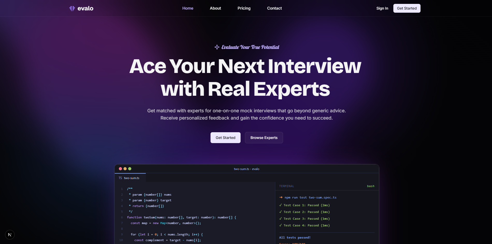

# Evalo

Evalo is a two-sided mock technical interview platform connecting candidates with vetted industry interviewers for live practice sessions and AI-driven performance evaluations.

## Overview

Preparing for technical interviews often lacks realistic simulation, structured feedback, and access to experienced industry practitioners. Evalo addresses this challenge by providing an on-demand booking platform where candidates practice live technical interviews over WebRTC video and chat. Interviewers define their availability, run structured sessions, and earn credits redeemable for monetary payouts. The platform tracks co-presence to settle sessions automatically and processes post-session audio transcripts with Google Gemini to generate comprehensive evaluation reports.

## Key Features

- **Role-Based Workflows**: Separate onboarding pipelines and role-gated dashboards for candidates and interviewers managed through Clerk authentication and Next.js edge route gating.
- **Availability Management**: Weekly recurring slot scheduling and availability status management for interviewers.
- **Slot Reservation & Escrow**: Atomic slot reservations with double-entry credit ledger accounting and transactional balance locks.
- **Live Interview Room**: Interactive WebRTC video and real-time chat powered by Stream SDK.
- **AI Question Generation**: Context-aware technical interview questions generated in real time during live calls via Google Gemini.
- **Algorithmic Co-Presence Settlement**: Automated webhook processing of Stream business events to compute simultaneous participant presence, classify completion outcomes, and resolve escrow without human mediation.
- **Automated AI Candidate Feedback**: Post-session transcription processing with Google Gemini delivering structured rubrics across technical accuracy, communication, and problem-solving.
- **Payments & Payouts**: Cashfree integration supporting subscription plan mandates for candidate credits and payout processing for interviewer earnings.
- **Abuse Prevention**: Arcjet rate limiting on booking endpoints to mitigate automated slot exhaustion.

## Tech Stack

| Category | Technology |
|---|---|
| **Language** | TypeScript, JavaScript |
| **Framework** | Next.js 16 (App Router, Standalone build) |
| **Frontend & UI** | React 19, Tailwind CSS v4, Radix UI primitives, Lucide React, Zustand, Sonner |
| **Database & ORM** | PostgreSQL (hosted on Supabase), Prisma ORM 7 with `@prisma/adapter-pg` |
| **Authentication** | Clerk (`@clerk/nextjs`) |
| **Video & Chat** | Stream Video & Chat SDKs (`@stream-io/video-react-sdk`, `stream-chat`) |
| **AI / Evaluation** | Google Gemini API (`@google/generative-ai`) |
| **Payments** | Cashfree (Payment Gateway & Cashgram Payouts) |
| **Security & Rate Limiting** | Arcjet (`@arcjet/next`), Svix (webhook signature verification) |
| **HTTP Client** | Ky |

## Deployment

- **Docker**: Multi-stage build with Next.js standalone output, running as a non-root user.
- **CI**: Pull requests to `staging` and `main` run lint, type checks, and a production build.
- **CD**: Pushes to `staging` run database migrations, publish the image to GitHub Container Registry, and redeploy on Render.

## License

Copyright (c) 2026 Samim Middey. All rights reserved.

This source code is provided for viewing and evaluation purposes only.
No permission is granted to copy, modify, distribute, or use it
without prior written permission from the copyright holder.
